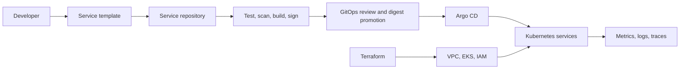

# platform-core

> A reference internal developer platform demonstrating service delivery, policy enforcement, and asynchronous workload operations on Kubernetes.

[](https://github.com/filipurminsky/platform-core/actions/workflows/ci.yaml)
[](https://github.com/filipurminsky/platform-core/actions/workflows/terraform-plan.yaml)

The platform gives application teams a supported path for creating a service,
delivering an immutable image, finding its telemetry, and diagnosing failures.
It also demonstrates a Kafka audio pipeline with shared retry, deduplication,
job-state, and trace propagation infrastructure.

**Scope:** local development uses Docker Compose or kind. The AWS EKS path is
authored but has **not been verified on a live AWS account**. Local LLM responses
come from a mock; STT and TTS use stub backends in both environments. This is an
engineering reference, with explicit [validation boundaries](docs/evidence.md),
not a claim of production operation or measured availability.

## Start here

- [Showcase walkthrough](docs/showcase.md): reproduce the developer journey and failure exercises.
- [Evidence matrix](docs/evidence.md): what each check establishes and what remains unverified.
- [Verified DEV run](docs/qa-followups-2026-11-10.md): clean-checkout bootstrap, recovery drills, hosted CI, and cleanup evidence.
- [Engineering case study](docs/case-study-worker-recovery.md): delivery guarantees, failure windows, and tradeoffs.
- [Local development](docs/local-dev.md): prerequisites, startup, access, and troubleshooting.
- [Architecture decisions](docs/architecture.md): ownership boundaries and accepted tradeoffs.

## What this demonstrates

| Developer or operator need | Implementation | Review entry point |
|---|---|---|
| Create and deliver a service | Backstage scaffolding, GitHub Actions, reviewed GitOps registration | [Templates](backstage/templates/) |
| Release safely | Argo Rollouts, canary-scoped Prometheus analysis, Gateway API routing | [Canary runbook](docs/runbooks/canary-rollback.md) |
| Verify supply chain | Trivy scans, SBOM/provenance, keyless signing, digest promotion, Kyverno admission | [Release workflow](.github/workflows/docker-build.yaml) |
| Isolate teams | Namespace components, quota tiers, RBAC, NetworkPolicies | [Tenant configuration](kubernetes/tenants/) |
| Operate asynchronous jobs | Kafka, shared retries/dedup, delivery-confirmed output, Redis state, S3 objects | [Shared worker library](services/platform-common/) |
| Debug requests across services | OTLP traces, structured logs, Prometheus metrics, Grafana | [Observability](observability/) |
| Provision app-facing storage | Namespaced Crossplane bucket API with platform-owned defaults; AWS validation pending | [Crossplane guide](docs/crossplane.md) |
| Manage infrastructure lifecycle | Terraform foundation; on-demand platform nodes and Karpenter burst/GPU capacity | [Prod Terraform](terraform/environments/prod/) |

## Architecture



Application source and deployable manifests live together under `services/`.
Platform-reviewed ApplicationSets under `kubernetes/apps/` select the service's
`dev` or `prod` overlay using the cluster's environment label. The
`kustomize/validation/` aggregates exist only for CI and local validation.

The audio path is `audio-api → stt-worker → llm-worker → tts-worker`, using Kafka
between stages and object keys rather than inline audio/text. Read the
[frozen contract](docs/audio-pipeline-contract.md) before changing that path.

## Quick start

For application development, install Docker with Compose and run from the repo root:

```bash
docker compose -f services/docker-compose.yml up -d --build
curl --fail http://localhost:8081/healthz
LLM_KEY=$(docker compose -f services/docker-compose.yml exec -T llm-worker printenv LLM_GATEWAY_API_KEY)
curl --fail -H "Authorization: Bearer $LLM_KEY" http://localhost:8080/v1/models
unset LLM_KEY
```

These are local development credentials. Compose exposes echo on `8081`,
llm-gateway on `8080`, and audio-api on `8082`; it does not exercise Kubernetes,
GitOps, admission, or autoscaling.

For the Kubernetes path, use Docker, kind **≥ 0.33.0**, kubectl compatible with
Kubernetes **1.36**, and Helm **4.3.1**. The kind configuration pins node image
**1.36.4**. Allocate at least 16 GiB of Docker memory for one full stack; the
observed QA nodes used about 11 GiB. Concurrent clusters and builds need more.
The verified cold-cluster bootstrap took about 39 minutes with existing host
tools/build caches; allow setup time separately from the demo.
See [local development](docs/local-dev.md) for setup and prerequisites.

```bash
./scripts/bootstrap.sh --mode=local --check
./scripts/bootstrap.sh --mode=local --require-published-source --wait
```

Bootstrap builds and loads all seven dev images. `--require-published-source`
checks that deployment inputs match published main; `--wait` checks all expected
Applications, Gateway programming, and routed health endpoints. Without `--wait`,
bootstrap only starts reconciliation. Child GitOps sources track main, so this
is not an immutable fleet pin. Local edits are not deployed by Argo CD.

Run `make dev-acceptance` for a disposable full-stack rehearsal covering Redis
recovery, Kafka/DLQ/audio, tenant isolation, public template generation, and
verified teardown. See [acceptance and startup measurements](docs/dev-acceptance.md)
for resource requirements, evidence, optional image caching, and manual CI.

## Validation

Python projects use Python **3.14** and separate uv environments/lockfiles.
Scaffolding checks also require Node.js/npm, uv, Kustomize, and conftest.
Use the tool pins and checksum-verified schema setup described in
[tool upgrades](docs/tool-upgrades.md) and [CI](.github/workflows/ci.yaml).

```bash
make help
make deps
make hooks
make schemas       # download/convert the pinned Kubernetes CRD schemas
make validate      # local non-cluster checks; see Makefile for exact coverage
```

`make validate` includes `make scaffold-test` (locked npm install and generated
service checks). `make infrastructure-test` is a separate Docker-based gate.
`make validate` is not the complete hosted CI pipeline. Image builds, security
scans, live cluster exercises, external account integration, and AWS validation
have separate prerequisites and evidence. See the [evidence matrix](docs/evidence.md).

## AWS preparation

Use `terraform/environments/prod/` for the AWS bootstrap path;
`bootstrap.sh --mode=aws` selects the `prod` Kubernetes overlays. Prepare the S3
state backend and AWS credentials, review a Terraform plan, and wire the
Terraform output ARNs, account-specific settings, and ECR image references before
bootstrap. The prod API endpoint is private by default, so the execution host
must have VPC access. [Crossplane](docs/crossplane.md) describes its additional
provider wiring. This path incurs AWS charges and is not a one-command verified demo.

## Repository map

| Directory | Responsibility |
|---|---|
| `services/` | Seven Python apps, shared worker library, vLLM manifests, Compose |
| `kubernetes/apps/` | Platform-reviewed service registration |
| `kubernetes/platform/` | Controllers, shared services, platform custom resources |
| `kubernetes/tenants/` | Team namespaces, quotas, RBAC, network boundaries |
| `terraform/` | Foundation infrastructure and IAM |
| `helm/` | Local demo-app, vLLM, and Backstage charts |
| `backstage/` | Catalog and service templates |
| `observability/` | Dashboards, alerts, SLO recording rules |
| `policy/`, `tests/`, `.github/` | Policy, behavioral checks, delivery automation |
| `docs/` | Decisions, runbooks, evidence, walkthrough |

## License

MIT
