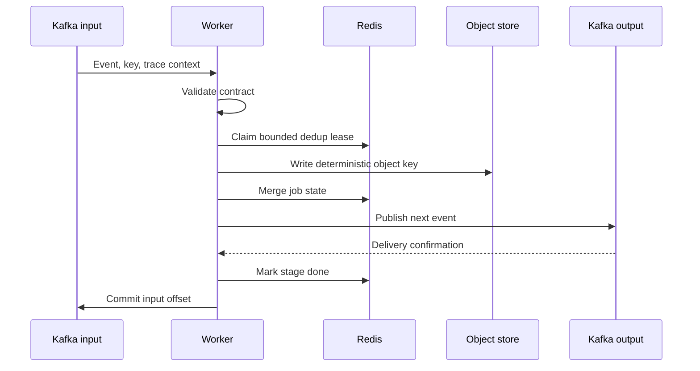

# Case study: recovering a Kafka stage without losing its output

## Problem and design boundary

The audio pipeline has three workers with the same operational needs: validate
an event, read/write an object, update job state, publish the next event, and
advance the Kafka consumer offset. A worker can fail between any two steps.
Copying the protocol into each service makes it easy for one stage to commit
before its output is durable or handle retries differently.

The implementation centralizes that protocol in
[`platform_common.stage`](../services/platform-common/src/platform_common/stage.py)
and keeps model-specific work in a handler returning `StageResult`. The
[consumer loop](../services/platform-common/src/platform_common/consumer_loop.py)
owns polling and offset commits. This is a separation between stage work and
delivery policy that can be tested independently.

## The sequence and its failure windows



The order matters: an input offset becomes committable only after confirmed
output or confirmed DLQ delivery. Invalid and permanent failures go to the
stage DLQ; transient retries share a bounded policy. A live claim held by
another worker produces `RETRY_LATER`, leaving the input uncommitted.

| Interruption point | Expected recovery | Remaining limitation |
|---|---|---|
| Before object/output delivery | Input is redelivered; an abandoned claim eventually expires | Lease duration adds recovery delay |
| After object write, before output confirmation | Retry can overwrite the deterministic object key and publish again | Repeated execution is possible; handlers must be idempotent |
| After output confirmation, before done marker | Output may be emitted again after redelivery | This is at-least-once delivery, not a transaction across stores |
| After done marker, before input commit | Redelivery sees completed stage and can commit without rerunning work | Depends on available, retained Redis state |
| Redis unavailable | Processing fails open to preserve progress | Deduplication protection is reduced; duplicates remain possible |

The Redis lease is not a distributed transaction or perpetual lock. Work that
outlives its lease, lost Redis state, and output acknowledgment ambiguity are
important boundaries. Deterministic writes reduce duplicate effects but do not
prove exactly-once execution. External side effects would need their own
idempotency keys or a stronger protocol.

## Why these choices

- **Object keys in Kafka:** replayed messages remain small; objects have stable
  names and independent lifecycle management. This also adds a storage dependency.
- **Delivery confirmation before commit:** avoids knowingly advancing past an
  output that the broker rejected. It permits duplicate output in a crash window.
- **Shared stage implementation:** fixes to retry/dedup/trace behavior reach all
  audio consumers, at the cost of requiring cross-consumer regression checks.
- **Redis fail-open dedup:** favors progress during state-store outages. The
  contract therefore requires idempotent processing rather than promising that
  every stage runs once.
- **Bounded retries and DLQs:** preserve consumer liveness and make poison jobs
  inspectable. Replay is an operational action, not an automatic guarantee of success.

## Evidence and reproduction

The [stage unit tests](../services/platform-common/tests/test_stage.py) cover
success, invalid events, permanent and transient failures, output delivery
failure, held claims, and failed DLQ delivery. Run:

```bash
(cd services/platform-common && OTEL_SDK_DISABLED=true uv run --frozen pytest -q)
make integration-test
make infrastructure-test
```

The in-process suite checks compatibility across service contracts with fake
infrastructure. The infrastructure suite adds actual broker, Redis, and S3 API
behavior and controlled interruption/recovery. Inspect its assertions and
saved output before claiming a particular crash window is covered. Neither
suite establishes AZ resilience, AWS IAM correctness, GPU performance, or
production availability. The [evidence matrix](evidence.md) records those boundaries.

## A defect found while restoring the cross-service tests

The old integration harness no longer modeled delivery callbacks or the shared
Redis operations, so it failed before exercising the full journey. Once those
fakes and test dependencies were repaired, the happy-path test exposed a real
identity bug: audio-api created a UUID as 32 hexadecimal characters, while the
shared event validator converted it to the hyphenated spelling. Both strings
represented a valid UUID, but they selected different Redis job keys. Workers
could complete under one key while the API kept polling the other.

The fix validates a UUID **without rewriting the supplied identity**. Regression
coverage checks the same Kafka key through every stage and polls the API using
the exact ID returned at upload. This preserves existing object/job identifiers
and avoids changing the frozen event contract. The repaired cross-service suite
passed all four tests in the implementation session; see the evidence record
for the associated limits.

The new real-infrastructure suite separately exercises SIGKILL after object
write, SIGKILL after confirmed output/dedup before commit, SIGTERM during retry,
and invalid-event DLQ handling. These targeted checks make recovery properties
observable without claiming that every distributed failure has been tested.

The [subsequent recovery drill](runbooks/redis-recovery.md) also tested the state
store itself. A first restore attempt exposed that starting Redis with AOF
enabled does not load an RDB-only backup as expected. The corrected procedure
loads the snapshot, enables AOF, then replaces the restored instance and checks
both recovered records and a new write. The [hosted acceptance record](qa-followups-2026-11-10.md)
ties those assertions to a successful workflow artifact. Restoring Redis still
does not atomically rewind Kafka offsets or object storage: older dedup state
can permit repeated work, so idempotent handlers remain necessary.

## How to present the result

Use a run's actual job ID and timeline: input accepted, interruption observed,
input offset still uncommitted, worker recovery, object/output/state verified,
and final offset committed. Include the commit, backend versions, run duration,
and logs. Discuss the duplicate-output window explicitly.

This is a design case study, not a fabricated production incident. Any future
incident report should record an actual failure, diagnosis, mitigation, and
regression check. Likewise, throughput/cost improvements require a measured
baseline before they can be claimed.
